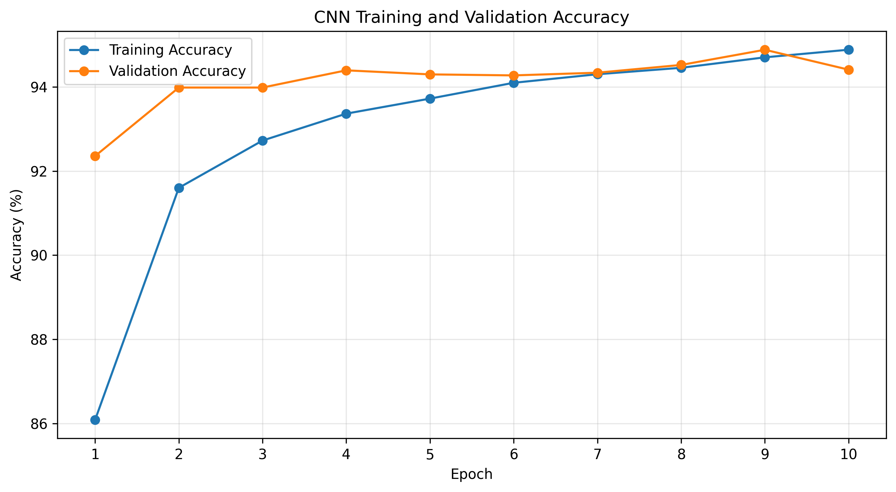
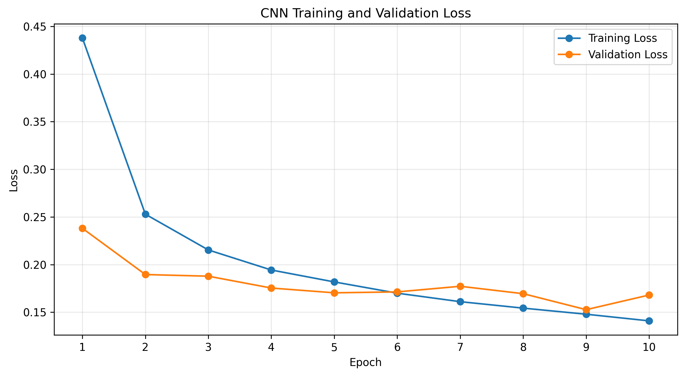
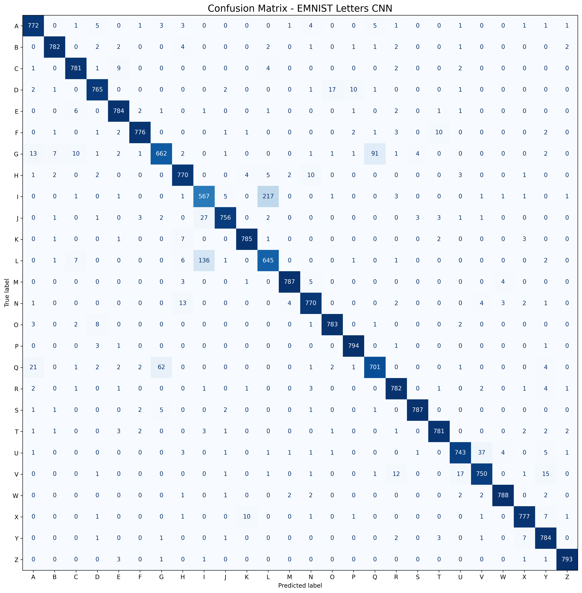

# Handwritten Character Recognition using CNN

A deep learning project that classifies handwritten English letters (A–Z) using a Convolutional Neural Network (CNN) trained on the EMNIST Letters dataset.

## Project Overview

This project implements a CNN model to recognize 26 handwritten English alphabet classes from grayscale images. The images are 28 × 28 pixels, and the model was developed and evaluated using PyTorch on a Kaggle GPU environment.

## Dataset

- **Dataset:** EMNIST Letters
- **Image size:** 28 × 28 pixels
- **Color channels:** 1 (grayscale)
- **Number of classes:** 26 (A–Z)
- **Training and validation:** 90% / 10% split of the original training set
- **Final test set:** 20,800 images

The original EMNIST letter labels were mapped to class indices 0–25, corresponding to A–Z.

## Model Architecture

The CNN contains:

- Convolutional layers with 32, 64, and 128 filters
- Batch normalization and ReLU activation
- Max pooling layers
- A fully connected layer with 256 neurons
- Dropout with a rate of 0.4
- A final output layer with 26 classes

**Total trainable parameters:** 1,705,690

## Training Configuration

- **Framework:** PyTorch
- **Optimizer:** Adam
- **Learning rate:** 0.001
- **Weight decay:** 0.0001
- **Loss function:** Cross-Entropy Loss
- **Batch size:** 128
- **Epochs:** 10
- **Learning rate scheduler:** ReduceLROnPlateau

The model with the best validation accuracy was selected for final test evaluation.

## Results

| Metric | Score |
|---|---:|
| Best Validation Accuracy | 94.88% |
| Test Accuracy | 94.54% |
| Macro Precision | 94.56% |
| Macro Recall | 94.54% |
| Macro F1-score | 94.53% |

The final evaluation was performed on a separate test set of 20,800 images.

## Training Curves

### Training and Validation Accuracy



### Training and Validation Loss



## Confusion Matrix



The confusion matrix shows that some visually similar letters are more difficult to distinguish. The most frequent confusion was between **I and L**, followed by **G and Q**.

## Project Files

- `handwritten_cnn_emnist.pth` — saved model weights
- `training_history.csv` — training and validation metrics for each epoch
- `classification_report.csv` — class-wise precision, recall, and F1-score
- `confusion_matrix.csv` — confusion matrix values
- `confusion_matrix.png` — confusion matrix visualization
- `accuracy_curve.png` — accuracy plot
- `loss_curve.png` — loss plot
- `evaluation_summary.json` — evaluation summary and label mapping

## Requirements

Install the main Python libraries with:

```bash
pip install torch torchvision numpy pandas matplotlib scikit-learn
```

## Loading the Trained Model

The saved `.pth` file contains the model weights. Recreate the same `HandwrittenCNN` architecture before loading the weights.

```python
import torch

# Create the same HandwrittenCNN architecture first.
model = HandwrittenCNN(num_classes=26)

state_dict = torch.load(
    "handwritten_cnn_emnist.pth",
    map_location="cpu",
    weights_only=True
)

model.load_state_dict(state_dict)
model.eval()
```

The `HandwrittenCNN` class definition and the same image preprocessing used during training are required to reproduce predictions correctly.

## Limitations

- Performance varies across letters; I/L and G/Q are commonly confused.
- The model was evaluated on EMNIST Letters and has not been established as reliable for every real-world handwriting style.
- The repository contains the trained weights and evaluation artifacts; the original training notebook is not included in this file list.

## Author

**Antara Masuma**

## Internship Project

CodeAlpha Internship — Handwritten Character Recognition
